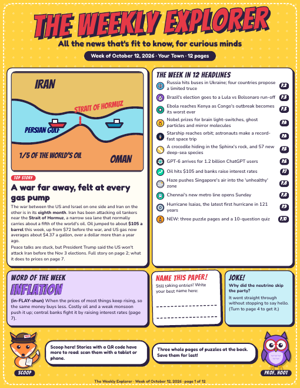
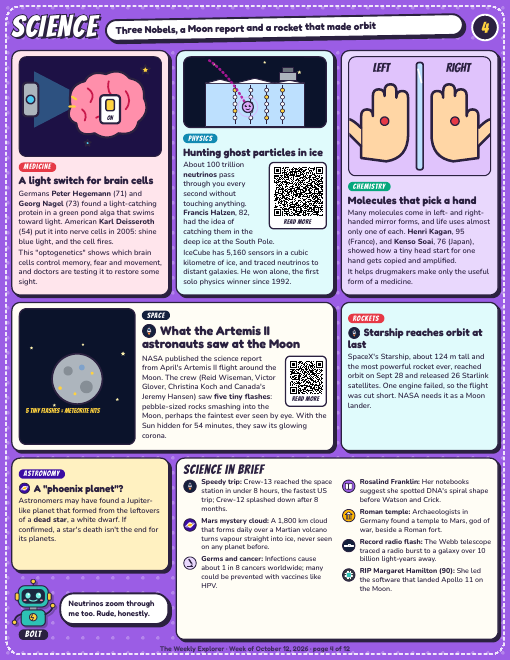
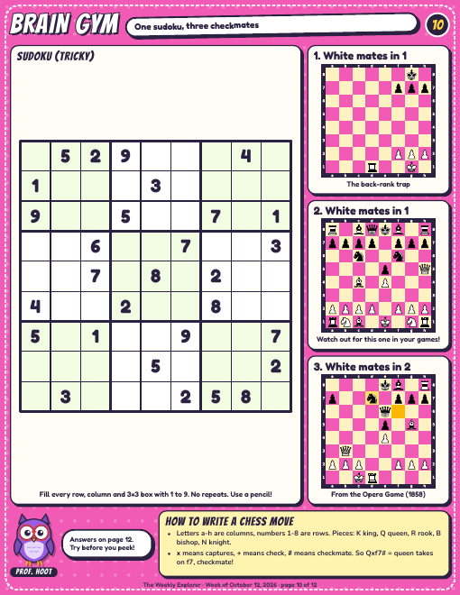

# Weekly Newspaper for Kids

A real weekly newspaper for your kid, printed at home: actual news from the past week
explained for their age, plus three pages of puzzles. Claude does the research and writing;
the code here does the layout, cartoons, puzzles and quality checks.

| Front page | Science page | Puzzle page |
|---|---|---|
|  |  |  |

Full 12-page sample: [examples/sample-issue.pdf](examples/sample-issue.pdf)

## What's in an issue
- **9 news pages:** world, science and space, animals, tech and AI, money, plus a heritage
  page and a local page you choose. Every fact is checked against a real article that week.
- **QR codes** on the bigger stories, so kids can read the full article on a tablet.
- **3 activity pages:** sudoku, chess puzzles, origami, brain teasers, a logic puzzle, a maze,
  a quiz on that week's news and a word search. All answers on the last page.
- **Cartoon mascots** with tips and jokes throughout.

The build checks itself: it fails if any text overflows its box, any chess answer is wrong,
the sudoku has more than one solution, or a QR code doesn't scan from the printed page.

## Quick start (about 20 minutes the first time)
1. **Make your own copy** of this repo (Fork, or "Use this template") so you can edit it.
2. **Fill in [`PROFILE.md`](PROFILE.md):** paper name, your kid's age and reading level,
   what they love, which heritage and local pages you want, topics to skip.
3. **Ask Claude to make an issue.** In Claude with code turned on (Claude Code, or the Claude
   app with your GitHub connected), attach your repo and say:
   > Make this week's issue following RUNBOOK.md.

   You get a PDF back in roughly 20-40 minutes.
4. **Print it** in colour on plain paper. US Letter prints fine on A4.

Then give feedback in plain words ("too long", "more animals", "she found the quiz too easy")
and ask Claude to update `PROFILE.md` so it sticks for next week.

To have it arrive every week without asking, see [AUTOMATION.md](AUTOMATION.md).

## Building by hand (if you like code)
```
pip install -r requirements.txt
playwright install chromium
python3 build.py examples/sample-issue.py
```
Needs Python 3.10+ and poppler (`brew install poppler` / `apt install poppler-utils`).
Output lands in `out/`: the PDF plus a PNG of every page.

## What's where
| File | What it is |
|---|---|
| `PROFILE.md` | Your kid and your paper. The only file most parents edit. |
| `RUNBOOK.md` | Step-by-step instructions Claude follows each week. |
| `AUTOMATION.md` | Optional: weekly schedule, preview email, auto-print. |
| `examples/sample-issue.py` | A complete real issue, used as the model for new ones. |
| `issues/` | Your issues go here, one file per week. |
| `build.py` | Layout engine, PDF render and QA checks. |
| `lib/art.py` | Mascots, illustrations and icons. Ask Claude to add new ones. |
| `lib/widgets.py` | Chess boards, sudoku, maze, word search, origami diagrams. |
| `lib/style.css` | The look: colours, fonts, boxes. |

## Good to know
- **It's only as good as your feedback.** The first issue will be close but not right.
  Two or three rounds of "more of this, less of that" gets it there.
- **Read it before your kid does,** at least for the first few weeks. Real news includes
  wars and disasters; the rules keep it factual and non-graphic, but you know your kid.
- Fonts are from Google Fonts (SIL Open Font License).
